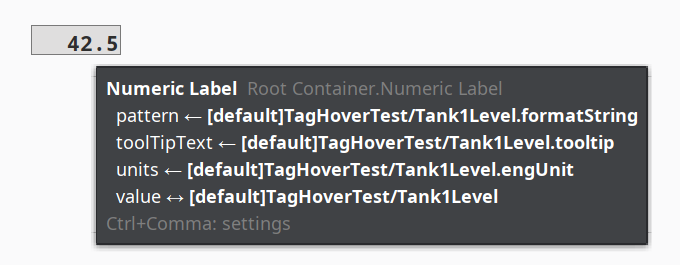

# Ignition Tag Hover Module

[](https://github.com/bearinmindcat/ignition-tag-hover-module/actions/workflows/build.yml)
[](https://inductiveautomation.com/)
[](#requirements)
[](LICENSE)

Hold **Ctrl** and hover over any Vision component, in a client or the Designer, to see which tags it's bound to.



Forum threads: [Vision: Tag Info popup on tag(s) under mouse](https://forum.inductiveautomation.com/t/vision-tag-info-popup-on-tag-s-under-mouse/25937) · [Determine origin of tips in the Ignition SCADA HMI](https://forum.inductiveautomation.com/t/determine-origin-of-tips-in-the-ignition-scada-hmi/111100)

## Features

- Works on every window and template, with nothing to set up per tag or project
- Direct, indirect, UDT and expression bindings, plus property bindings followed back to their tag
- Resolved paths for indirect bindings, bad quality flags, and `↔` for bidirectional bindings
- Each user picks their own key, held or tapped on and off
- Free, with no license or trial timer

## Requirements

- Ignition 8.1.35 or newer 8.1 (8.3 isn't supported yet)
- Vision clients and the Designer, in design and preview mode (not Perspective)
- A mouse and keyboard, since touchscreens have no hover

## Installation

1. Download `Tag-Hover-Tooltip.unsigned.modl` from [Releases](https://github.com/bearinmindcat/ignition-tag-hover-module/releases).
2. Allow unsigned modules: add `wrapper.java.additional.N=-Dignition.allowunsignedmodules=true` (with the next free `N`) to `ignition.conf`, then restart the Gateway.
3. In the Gateway, go to **Config → Modules → Install or Upgrade a Module** and choose the file.
4. Reopen Vision clients and the Designer.

## Usage

Hold **Ctrl** and hover over a component. The tooltip goes away when you let go, click, scroll, or press a shortcut such as Ctrl+C.

Press **Ctrl+Comma** to open the settings, or in the Designer use **Tools → Tag Hover Settings…**. Choose a key from the list, or click **Press a key…** and press it. You can also switch to **Tap** mode, where one tap turns tag hover on and another tap or Esc turns it off. Settings are saved per Windows user. Scripts can open them with `system.taghover.openSettings()`, for example from a client menu item.

## Building

Requires JDK 17 or 21.

```
./gradlew build             # build/Tag-Hover-Tooltip.unsigned.modl, and the unit tests
./gradlew :client:runDemo   # try it without a Gateway: real Vision components with fake tags
```

To sign the module, set `ignition.signing.keystoreFile`, `keystorePassword`, `certFile`, `certAlias` and `certPassword` in `~/.gradle/gradle.properties`. The build then also writes `build/Tag-Hover-Tooltip.modl`.

## License

[MIT](LICENSE). Issues and pull requests are welcome.

*Not affiliated with or endorsed by Inductive Automation. Ignition is a trademark of Inductive Automation.*
