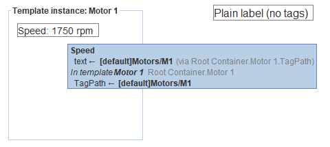

# Ignition Tag Hover Module

[](https://github.com/bearinmindcat/ignition-tag-hover-module/actions/workflows/build.yml)
[](LICENSE)

An Ignition Vision module. Hold **Ctrl** and hover over any component, in a running Vision client or in the Designer, to see which tags it's bound to.



> **Status:** early development. The module builds and its tests pass against the Ignition 8.1.35 SDK, but it has not been tested on a live Gateway yet. There is no release yet.

## Why

There's no built-in way to see which tag drives a value on a running Vision screen. You have to open the project in the Designer and go through bindings one component at a time. People have been asking for this for years:

- [Vision: Tag Info popup on tag(s) under mouse](https://forum.inductiveautomation.com/t/vision-tag-info-popup-on-tag-s-under-mouse/25937) (2019). The request is for a hotkey that shows the tag(s) under the mouse on every component, without per-screen setup. No solution was posted.
- [Determine origin of tips in the Ignition SCADA HMI](https://forum.inductiveautomation.com/t/determine-origin-of-tips-in-the-ignition-scada-hmi/111100) (2025). That project is Perspective, but the problem is the same: "The only way to know is to inspect the project itself."

## Features

- **Works on every window automatically.** Nothing to configure per tag, window or project.
- **Direct, indirect and UDT tag bindings.** Indirect bindings show the resolved path and the `{1}` pattern.
- **Expression bindings:** lists the tags referenced with `{[default]...}` and `tag("...")`.
- **Property bindings followed back to the tag**, for example a label bound to a custom property that is bound to a tag.
- **Templates:** shows the template instance's tag parameters.
- **Quality and write-back:** flags bad quality (e.g. `Bad_NotFound`) and marks bidirectional bindings with `↔`.
- **Free module:** no license and no trial timer.

## Requirements

- Ignition **8.1.35** or newer 8.1.x, with the **Vision** module
- Ignition 8.3 is not supported yet

## Installation

1. Download `Tag-Hover-Tooltip.unsigned.modl` from [Releases](https://github.com/bearinmindcat/ignition-tag-hover-module/releases), or [build it](#building).
2. The module is unsigned, so the Gateway must allow unsigned modules. In `ignition.conf` (Windows default: `C:\Program Files\Inductive Automation\Ignition\data\ignition.conf`), add a line using the next free number in the `wrapper.java.additional.*` list:
   ```
   wrapper.java.additional.10=-Dignition.allowunsignedmodules=true
   ```
   Then restart the Gateway.
3. In the Gateway web interface, go to **Config → Modules → Install or Upgrade a Module** and choose the `.modl` file.
4. Restart any open Vision clients and reopen the Designer.

## Usage

Hold **Ctrl** and hover over a component. The tooltip disappears when you release Ctrl, click, scroll, or press a Ctrl shortcut such as Ctrl+C.

## Building

Requires JDK 17 or 21. The Gradle wrapper downloads everything else.

```
./gradlew build
```

The module is written to `build/Tag-Hover-Tooltip.unsigned.modl`.

### Signed builds

A signed module installs without the unsigned-modules flag. The Gateway asks once whether to trust its certificate, and later versions signed with the same certificate install without asking. To sign, add your keystore details to `~/.gradle/gradle.properties`:

```
ignition.signing.keystoreFile=/path/to/keystore.pfx
ignition.signing.keystorePassword=...
ignition.signing.certFile=/path/to/cert.p7b
ignition.signing.certAlias=...
ignition.signing.certPassword=...
```

`./gradlew build` then also writes the signed `build/Tag-Hover-Tooltip.modl`.

## Testing

```
./gradlew :client:test        # unit tests against the real Vision 8.1.35 classes
./gradlew :client:runDemo     # try it without a Gateway: a window of real Vision components with fake tags
./gradlew :client:demoCheck   # scripted Ctrl+hover on every demo component; screenshots go to client/build/demo
```

## How it works

Vision stores each window's bindings in an internal `InteractionController`. The module listens for Ctrl and mouse movement application-wide, finds the component under the pointer, and reads that component's bindings. Windows and components are never modified.

These are internal Vision classes, not a published API, so a future Ignition version may need a small update.

## Limitations

- Not covered yet: tag history, cell update, SQL and named-query bindings, and tags read from scripts.
- Touchscreens have no hover, so the tooltip needs a mouse and keyboard.
- In the Designer, hover lookup at canvas zoom levels other than 100% is unverified.

## Contributing

Issues and pull requests are welcome.

## License

[MIT](LICENSE)

*Not affiliated with or endorsed by Inductive Automation. Ignition is a trademark of Inductive Automation.*
