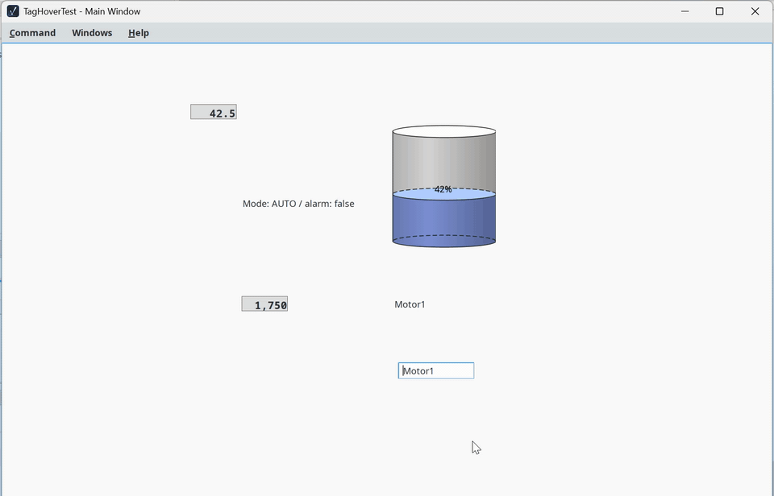
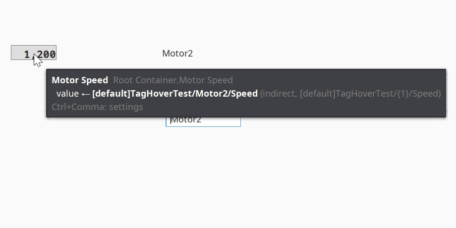
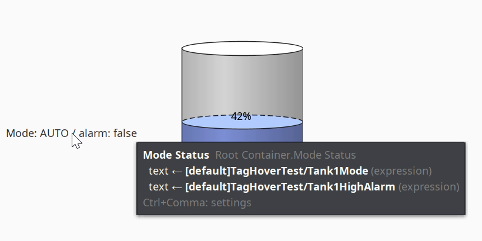
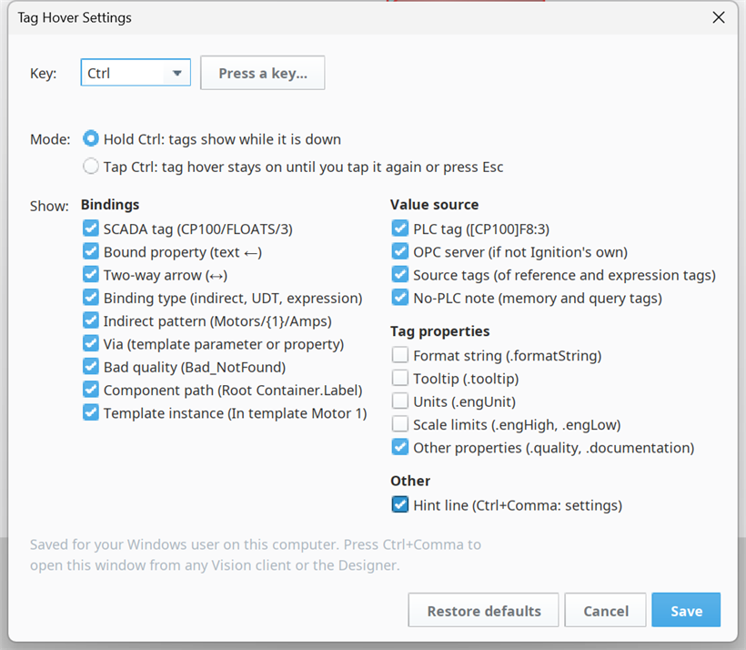
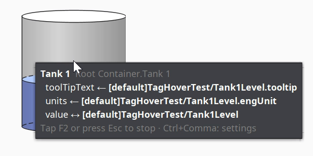

# Ignition Tag Hover Module

[](https://github.com/bearinmindcat/ignition-tag-hover-module/actions/workflows/build.yml)
[](https://inductiveautomation.com/)
[](#requirements)
[](LICENSE)

Hold **Ctrl** and hover over any Vision component, in a client or the Designer, to see which tags it's bound to and the PLC address behind each one.

<p align="center">
  
  <br>
  <sub>A Vision client on Ignition 8.1.35: hold Ctrl, switch the motor and watch the indirect binding follow, then set F2 and tap mode in the settings. About 0:50, sped up; the <a href="docs/demo.mp4">full video</a> (MP4, 1:11) plays at real speed and full resolution. It works the same way in the Designer.</sub>
</p>

Forum threads: [Vision: Tag Info popup on tag(s) under mouse](https://forum.inductiveautomation.com/t/vision-tag-info-popup-on-tag-s-under-mouse/25937) · [Determine origin of tips in the Ignition SCADA HMI](https://forum.inductiveautomation.com/t/determine-origin-of-tips-in-the-ignition-scada-hmi/111100)

## Features

<table>
<tr>
<td width="50%"><br><sub>Indirect bindings show the tag they resolve to right now, and the pattern behind it.</sub></td>
<td width="50%"><br><sub>Expressions list every tag they read, whether written as <code>{...}</code> or <code>tag("...")</code>.</sub></td>
</tr>
<tr>
<td width="50%"><br><sub>Ctrl+Comma opens the settings. Pick a key from the list or press it, choose to hold or tap it, and tick what the tooltip shows. Saved per Windows user.</sub></td>
<td width="50%"><br><sub>Tap mode: one tap and the tooltips follow the mouse with no key held, until another tap or Esc.</sub></td>
</tr>
</table>

Under each tag is where its value comes from:

```
Mode Status   Root Container.Mode Status
  text ← [default]Plant/Tank1Level
      PLC [CP300]F8:23
  text ← [default]Plant/TotalEffluent
      expression tag, reading:
         [default]Plant/FIT704 · PLC [CP400]Global.F8.F8[119]
         [default]Plant/FIT718 · PLC [CP400]Global.F8.F8[121]
  text ← [default]Plant/HighAlarm
      reference to [default]Plant/PLC/HighSwitch · PLC [CP100]Global.F8.F8[17]
```

- OPC tags show their PLC address (the OPC item path), with UDT parameters filled in, and the OPC server if it isn't Ignition's own.
- Reference and derived tags show the tag they point at, and expression tags the tags they read, each with its PLC address.
- Memory and query tags are marked as having no PLC.

It reads the tags' settings from the Gateway, once per tag, and never contacts a PLC.

Also: direct and UDT tag bindings, property bindings followed back to their tag, template parameters (including members of a UDT parameter, such as `Motor1/Amps`), bad quality flags, and `↔` for bidirectional bindings. It works on every window with nothing to set up, and it's free, with no license or trial timer.

## Requirements

- Ignition 8.1.35 or newer 8.1 (8.3 isn't supported yet)
- Vision clients and the Designer, in design and preview mode (not Perspective)
- A mouse and keyboard, since touchscreens have no hover

## Installation

1. Download `Tag-Hover-Tooltip.modl` from [Releases](https://github.com/bearinmindcat/ignition-tag-hover-module/releases).
2. In the Gateway, go to **Config → Modules → Install or Upgrade a Module** and choose the file. The first time, the Gateway asks you to trust its certificate (`bearinmindcat`).
3. Reopen the Designer. Vision clients that are already open pick it up without a restart.

Uninstalling from the same page removes it from open clients too, without interrupting them.

<sub>Building it yourself, or prefer an unsigned build? `Tag-Hover-Tooltip.unsigned.modl` is on each release too; it needs `wrapper.java.additional.N=-Dignition.allowunsignedmodules=true` (the next free `N`) in `ignition.conf` and a Gateway restart.</sub>

## Usage

Hold **Ctrl** and hover over a component. The tooltip goes away when you let go, click, scroll, or press a shortcut such as Ctrl+C.

Press **Ctrl+Comma** to open the settings, or in the Designer use **Tools → Tag Hover Settings…**. Scripts can open them with `system.taghover.openSettings()`, for example from a client menu item. Untick anything you don't want in the tooltip. Bindings to a tag's own format string, tooltip, units and scale limits are hidden by default, since they repeat the same tag. With every "Value source" box unticked, it doesn't read tag settings from the Gateway at all.

## Building

Requires JDK 17 or 21.

```
./gradlew build             # build/Tag-Hover-Tooltip.unsigned.modl, and the unit tests
./gradlew :client:runDemo   # try it without a Gateway: real Vision components with fake tags
```

To sign the module, set `ignition.signing.keystoreFile`, `keystorePassword`, `certFile`, `certAlias` and `certPassword` in `~/.gradle/gradle.properties`. The build then also writes `build/Tag-Hover-Tooltip.modl`.

## License

[MIT](LICENSE). Issues and pull requests are welcome.

*Not affiliated with or endorsed by Inductive Automation. Ignition is a trademark of Inductive Automation.*
